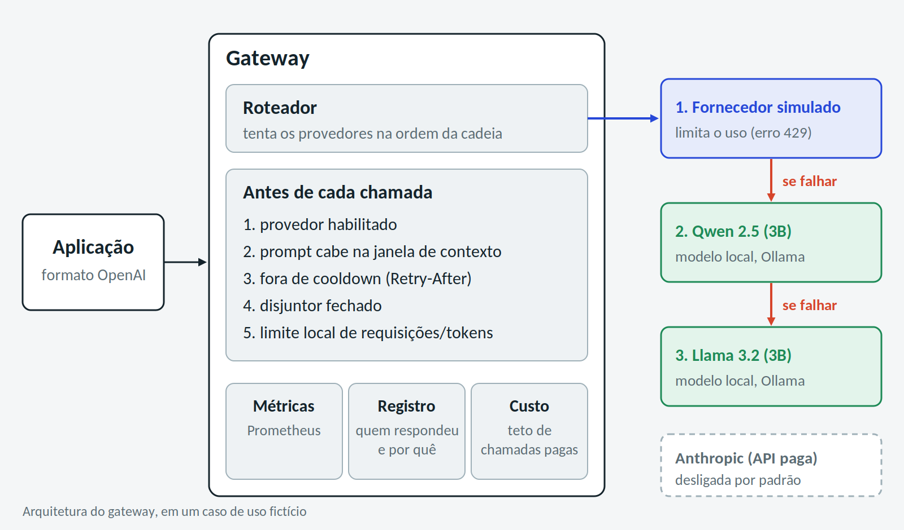
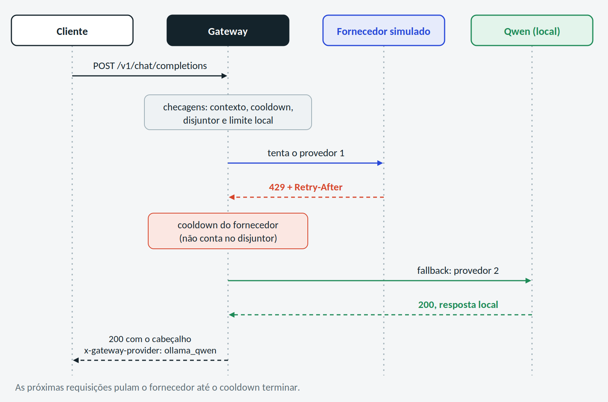

Quando uma aplicação depende de um único fornecedor de LLM, qualquer limite de uso ou queda do serviço vira problema dela. O LLM Gateway é a camada intermediária que resolve isso: as aplicações falam só com ele, e ele decide para onde cada requisição vai.

Este texto resume um estudo feito em um caso de uso fictício: um fornecedor de mercado simulado, que limita o uso, e dois modelos locais (Qwen e Llama, rodando no Ollama) como reserva. O código está em https://github.com/jcorreaviana/llm-gateway-study.

## Quais funcionalidades o gateway entrega?

O gateway recebe requisições no formato da OpenAI e tenta os provedores em ordem: o fornecedor simulado, depois o Qwen, depois o Llama.

- **Limite de uso (429):** respeita o `Retry-After`, pausa só aquele provedor e não conta isso como falha de saúde dele.
- **Falha de verdade (5xx, timeout):** um disjuntor abre depois de 3 falhas seguidas e, antes de voltar ao provedor, faz uma chamada de teste.
- **Antes de chamar:** aplica limite local de requisições e de tokens e confere se o prompt cabe na janela de contexto do provedor.
- **Observabilidade:** métricas no Prometheus e registro de quem respondeu cada pedido e por quê.
- **Custo:** a API paga começa desligada, com teto de chamadas. Em todo o estudo não houve nenhuma chamada paga.

O fluxo de uma requisição quando o fornecedor limita o uso:

O código tem cerca de 760 testes e passa por varredura de segredos antes de cada commit. Também foi quebrado de propósito, de tempos em tempos, para conferir se os testes detectavam o problema. Alguns não detectavam, e isso foi corrigido.

## O que se perde ao trocar de modelo?

Foram montados 48 prompts sintéticos em português, em 6 tipos de tarefa (classificação, extração, raciocínio, instrução, uso de ferramenta e resumo). O Qwen (3B) e o Llama (3B) responderam a todos, cada um pelo gateway.

Neste conjunto, o Qwen foi aprovado em 87,5% das respostas e o Llama em 64,6%. Em 12 prompts só o Qwen acertou, e em 1 só o Llama (p = 0,003). Por tipo de tarefa, com 8 prompts cada, nenhuma diferença é conclusiva, então não dá para afirmar em qual tipo um modelo é melhor. Raciocínio foi o pior para os dois (50% e 37,5%), em parte porque o enunciado proibia explicar a resposta, efeito que não foi medido.

Um limite importante: a comparação é entre dois modelos locais. **Ela não mede a perda em relação a um modelo de mercado.** Para isso seriam necessárias chamadas pagas, e isso ficou como próximo passo.

## Dá para usar um modelo pequeno como avaliador?

Para avaliar respostas abertas, como resumos, os próprios modelos locais foram testados como juízes. Antes da execução, foi fixado um critério: o juiz só seria usado se concordasse com as regras determinísticas em pelo menos 80% dos casos e com kappa de 0,6 ou mais.

Nenhum dos dois passou. O melhor acertou 77,5%, e um juiz que aprovasse tudo acertaria 73,8%, ou seja, quase não discrimina. Os kappas ficaram em 0,17 e 0,23, e os dois juízes tiveram forte viés de posição, preferindo a resposta apresentada primeiro ou segundo, e quase não concordaram entre si (kappa de 0,04). As notas dos juízes ficaram marcadas como não confiáveis, e os resumos foram avaliados só por regras e por revisão humana. Julgar a qualidade de uma IA com outra IA pequena não é de graça.

## Gateway próprio ou LiteLLM?

As mesmas cenas foram executadas no LiteLLM (versão 1.103.1), um gateway de código aberto bastante conhecido. Com a configuração certa, os dois fazem o essencial: trocam de provedor, respeitam o `Retry-After` quando o cooldown abre e param de insistir no que está falhando. As diferenças observadas, nesta versão e nesta configuração:

- **Falhas intercaladas:** o gateway próprio conta falhas seguidas. O LiteLLM conta numa janela de tempo, e um sucesso no meio não zera a contagem.
- **Um 429 isolado:** o gateway próprio espera o tempo do `Retry-After`. O LiteLLM volta ao provedor na hora, sem cooldown.
- **Recuperação:** o gateway próprio testa com uma chamada antes de voltar. O LiteLLM volta direto.
- **Quando tudo falha:** o gateway próprio devolve um 503 com o motivo de cada provedor. O LiteLLM devolveu o status do primeiro provedor, em texto livre, nos dois casos testados.

O achado que mais surpreende: o valor padrão de `allowed_fails` deixa o contador de falhas inativo, e o proxy nunca para de chamar o provedor que está caindo. O LiteLLM é um produto muito mais amplo do que o recorte comparado aqui.

## Quais cuidados de segurança foram necessários?

Em março de 2026, duas versões do LiteLLM no PyPI foram publicadas comprometidas. Por isso a instalação foi feita em ambiente isolado, com hashes, só wheels e uma trava que bloqueia qualquer conexão fora da máquina.

A trava bloqueou uma tentativa de download logo no primeiro start. Era um arquivo de cache do tokenizador que o pacote tentava baixar porque a verificação de integridade falhava. Com o cache corrigido localmente, nenhuma tentativa de saída foi bloqueada nas 66 subidas seguintes do proxy.

## Construir ou comprar?

Os dois chegam ao mesmo lugar em parte das situações, e a escolha é entre construir e comprar.

- **LiteLLM:** vale quando a necessidade é ampla e precisa estar no ar rápido.
- **Gateway próprio:** faz sentido quando a necessidade é estreita e específica. A superfície é pequena, dá para encaixar regras próprias (por exemplo, mandar tarefas simples para o modelo local e as difíceis para o de mercado, usando as notas da avaliação) e não há dependência do roadmap de terceiros.
- **Custo de construir:** manter tudo, inclusive o que ainda falta: streaming, autenticação, estado compartilhado entre instâncias e tráfego real.

## Quais são os limites do estudo?

Foi um caso fictício, com um fornecedor simulado, uma máquina, 48 prompts e um único revisor humano, que viu a nota das regras ao decidir. Os números valem para este experimento e não se generalizam.
